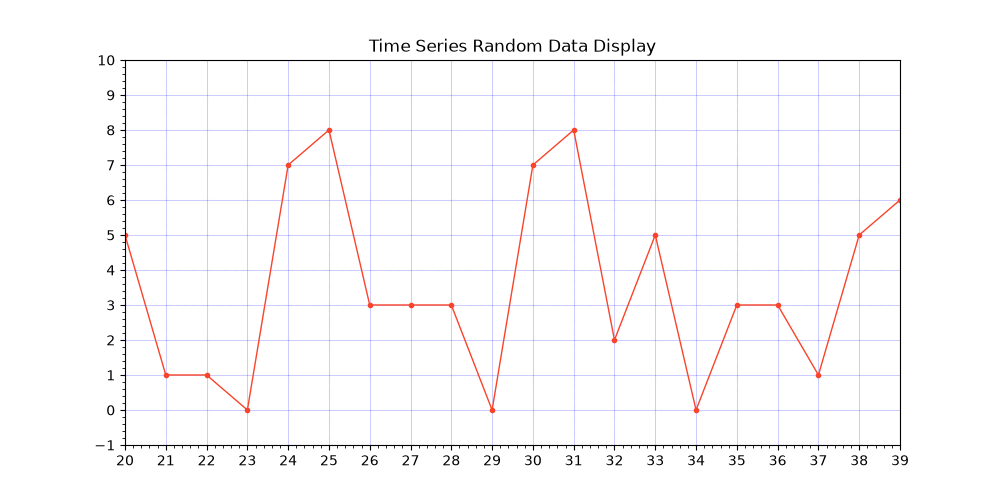
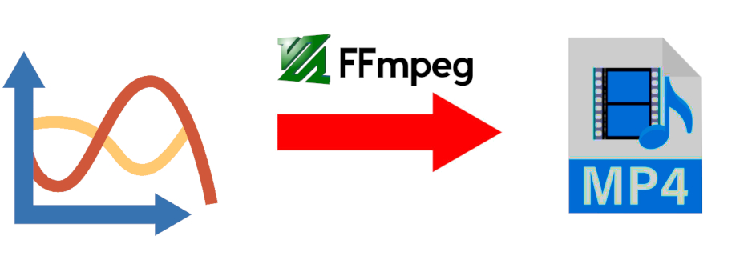
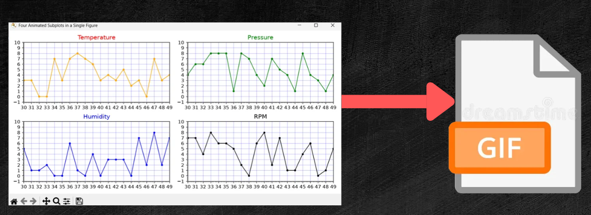
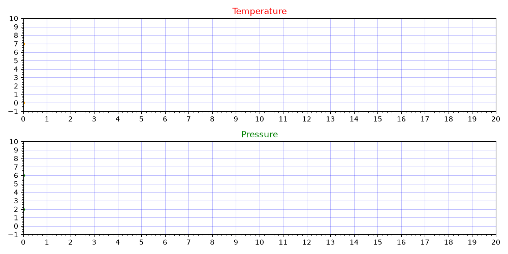
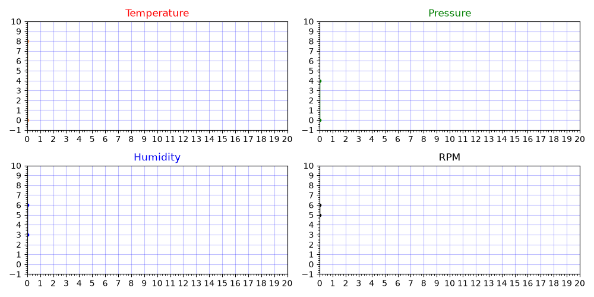
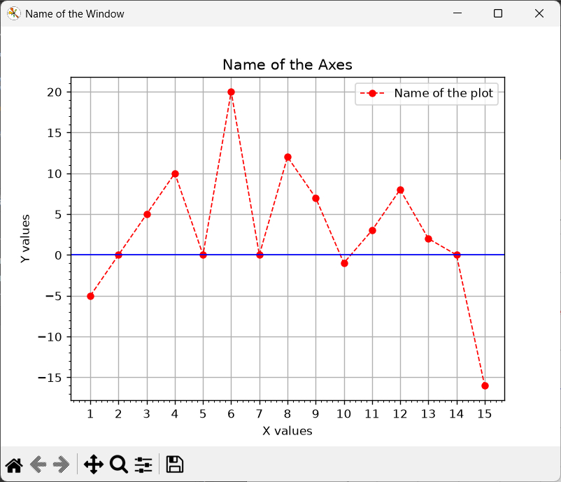
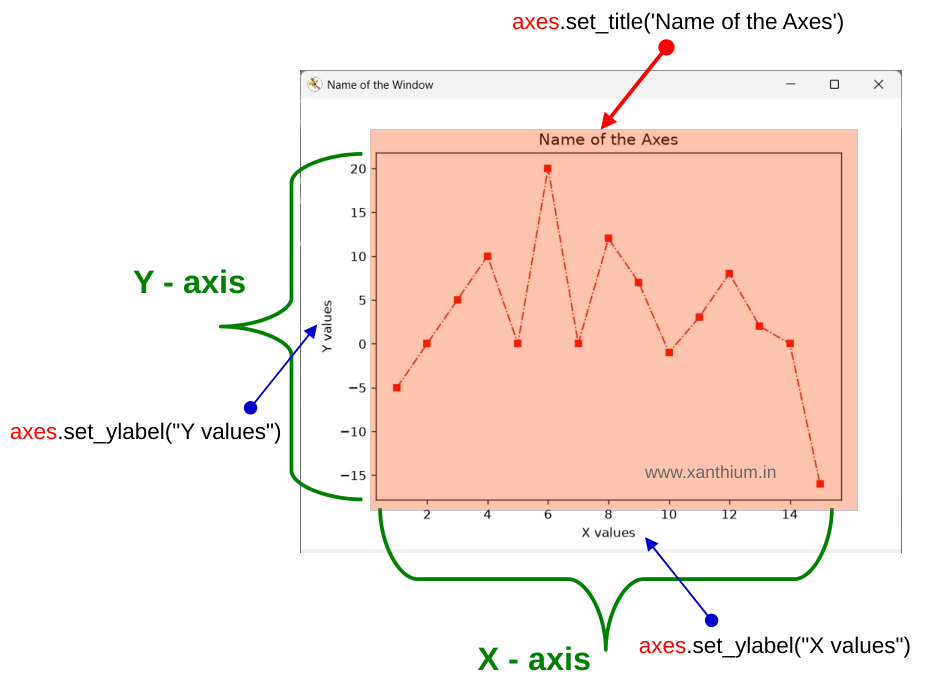
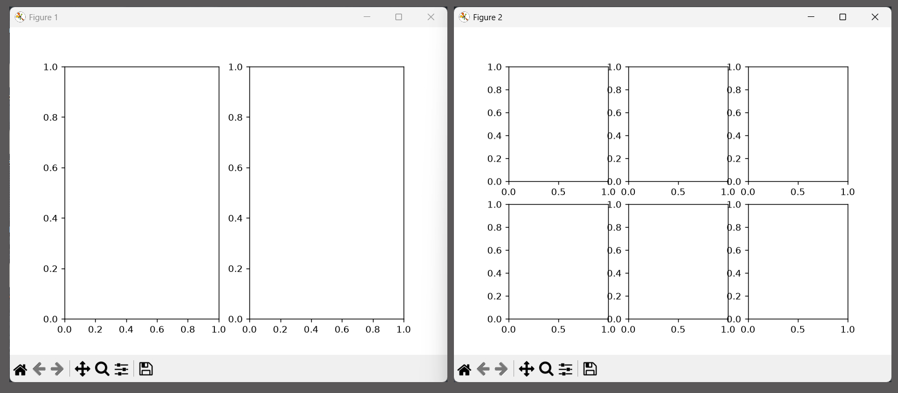
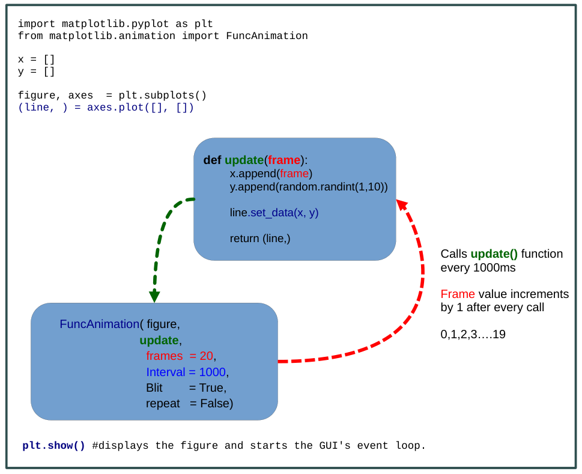

# Matplotlib Library Plotting and Animation Crash Course Tutorials for Absolute Beginner

A beginner friendly collection of Python examples for learning how to create, customize, organize, and animate line charts using Matplotlib Library and Python.

In this tutorial collection repo , we will learn how to create and animate line graphs in Python using the Matplotlib library to visualize data received from Arduino boards and other embedded systems. We will begin by exploring the fundamental concepts of Matplotlib, including Figures and Axes, and then learn how to customize graphs by creating ticks, changing the colour and thickness of plot lines, modifying default markers, and enabling or disabling grid lines.

We will also learn how to create real-time animations using Matplotlib's *FuncAnimation()* function to plot data received from external sources such as Arduino and data acquisition systems like LabJack. The tutorial will demonstrate how to create multiple subplots (Axes) within a single Matplotlib window (Figure) using plt.subplots() and animate them simultaneously in real time. In addition, we will explore how to animate multiple lines across multiple plots to visualize different types of time-series data, such as temperature, pressure, RPM, and other sensor readings.

- 

Furthermore, we will learn how to save animated Matplotlib plots as MP4 video files using the H.264 codec and the open-source FFmpeg multimedia framework. This includes downloading the correct FFmpeg library for your operating system, configuring it, adding it to the system PATH, and making it accessible to the PyCharm IDE. We will also cover how to troubleshoot commonly encountered errors, such as RuntimeError: Requested MovieWriter (ffmpeg) not available, when converting Matplotlib animations into video files.

- 

Finally, we will learn how to convert animated Matplotlib plots into GIF images and save them to disk so they can be shared with others or embedded in web pages. Using the ani.save() method of the FuncAnimation() class, along with image-processing libraries such as Pillow or ImageMagick, we will explore how to save animations as GIF files and customize their properties, including frame rate, DPI resolution, and image size

## Tutorial

- [Matplotlib Library Crash Course for Absolute Beginner](https://www.xanthium.in/creating-animating-line-charts-matplotlib-absolute-beginners)
- [Complete Matplotlib Plotting Tutorial using Python for Absolute Beginners-Youtube](https://www.youtube.com/watch?v=r2hsO3cffu4)
- [Matplotlib Animation Tutorial for Absolute Beginner using Python (Youtube)](https://www.youtube.com/watch?v=CZHtWocvQdc)
- [Animating Multiple Matplotlib Subplots inside a Single Window using FuncAnimation() Class & Python](https://www.youtube.com/watch?v=KOe_P13kwes)
- [How to convert Matplotlib plot animation to a gif image (image.gif)](https://www.youtube.com/watch?v=qDLGvr40nKg)
- [How to Convert and Save An Animated Matplotlib Plot to a MP4 Video Using FFmpeg and Python](https://www.youtube.com/watch?v=9rraGrEt4q0)

-----------------------------------------------------------------------------------------------------------------------------------------------------

- [Installing Matplotlib Library using Powershell Command line ,Thonny or PyCharm IDE on Windows 11](https://www.youtube.com/watch?v=98mmxymOnf8)
- [Creating a Simple line plot using Matplotlib Library and Python tutorial for Beginners](https://www.youtube.com/watch?v=sOuRdaNnrA0)
- [How to change the plot line color, line style, line thickness, marker size, shape in Matplotlib Plot](https://www.youtube.com/watch?v=fAQdD5B1qBY)
- [Changing the name of the Matplotlib Window, Plotting Area (axes),X and Y axis](https://www.youtube.com/watch?v=7n5o-nkTAf4)
- [What are Ticks and How to configure Major and Minor Ticks on a Matplotlib Plot using Python](https://www.youtube.com/watch?v=cp0Hbq-rxs4)
- [Matplotlib set_xlim() & set_ylim() Explained | Control X & Y Axis Limits in Python](https://www.youtube.com/watch?v=q50tsFooxLY)
- [How to Create Multiple Subplots in One Figure Using Matplotlib & Python Tutorial](https://www.youtube.com/watch?v=KqAaabDGCDQ)
- [How to Enable, Configure and Customize Grid lines on a Matplotlib plot using Python](https://www.youtube.com/watch?v=-D-TF2MNbkU)

## Animating the Plots using FuncAnimation() class and Python

## Animating 4 subplots inside a Single Matplotlib Window.
In this example we will animate 4 matplotlib plots concurrently inside a single window using  Python and FuncAnimation. The Subplots will be arrangedin a 2X2 grid inside the main window or figure.

## What you will Learn in this Tutorial collection

- Installing Matplotlib
- Understanding Figure and Axes
- Creating basic line charts using Matplotlib Library 
- Customizing line styles, colors, and thickness
- Changing marker shapes and sizes
- Adding titles and axis labels 
- Creating legends
- Enabling and customizing grid lines
- Highlighting specific horizontal and vertical lines
- Controlling major and minor ticks on MatplotLib
- Using MultipleLocator to place ticks automatically
- Creating multiple plots in one figure
- Creating 2×2 subplot layouts
- Understanding the basics of real-time line-chart animation in Matplotlib Library
- Animating a Line Chart in Real Time using Matplotlib
- How FuncAnimation() works in Matplotlib
- Saving the Matplotlib Animated Graph as a GIF Image
- Creating a Line Scrolling Real time Line Chart in Matplotlib Library
- Implementing Scrolling Action in Matplotlib
- Animating multiple subplots inside a single Matplotlib window
- Animating 4 Subplots in Realtime using FuncAnimation()
- Saving Matplotlib Animated Plot to a GIF Image
- Saving Matplotlib Animated Plot to a MP4 Video using FFmpeg
- Installing FFmpeg on Windows 11
- Checking whether FFmpeg is Detected by PyCharm IDE
- Creating a MP4 Video from Matplotlib Plots 

## Images 

- 

- 

- 

- 

## Real-Time Line Chart Animation using Matplotlib Library and Python.

The tutorial also introduces the idea of animating a line chart for data received from an external source such as an Arduino or [data acquisition system](https://www.youtube.com/watch?v=hpHv4Iux6_s).

This is particularly useful for applications such as

- Sensor monitoring
- Temperature logging
- Real-time voltage/current monitoring
- Arduino projects
- Raspberry Pi projects
- Data acquisition systems
- Embedded-system dashboards

Matplotlib provides the FuncAnimation class for updating plots repeatedly as new data becomes available.

## References

- [Build your own Data Acquisition and Logging System to CSV file using Python and Arduino](https://www.xanthium.in/python-data-acquisition-system-daq-arduino-log-to-csv-file)

- [GUI Serial port Data Logging System to CSV text file using Python and tkinter (ttkbootstrap)](https://www.xanthium.in/multithreading-serial-port-data-acquisition-to-csv-file-using-producer-consumer-pattern-python)

- [Real-Time Line Chart Animation using Matplotlib Library and Python](https://www.xanthium.in/creating-animating-line-charts-matplotlib-absolute-beginners)

- [Real Time Graph Animation in Matplotlib Using FuncAnimation() and Python for Beginners](https://www.instructables.com/Real-Time-Live-Data-Plotting-in-Matplotlib-Using-F)
- [Creating and Configuring a Line Chart (line Plot) in Matplotlib Using Python for Beginners](https://www.instructables.com/Creating-and-Configuring-a-Line-Chart-in-Matplotli)